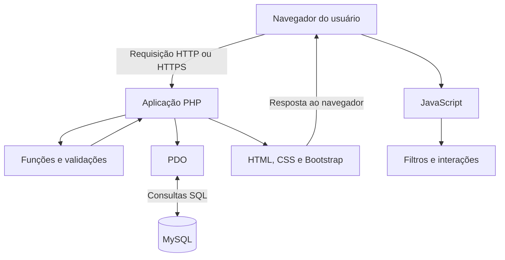
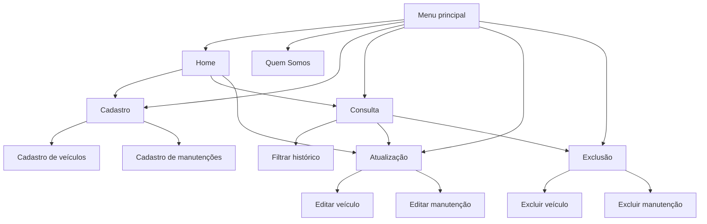
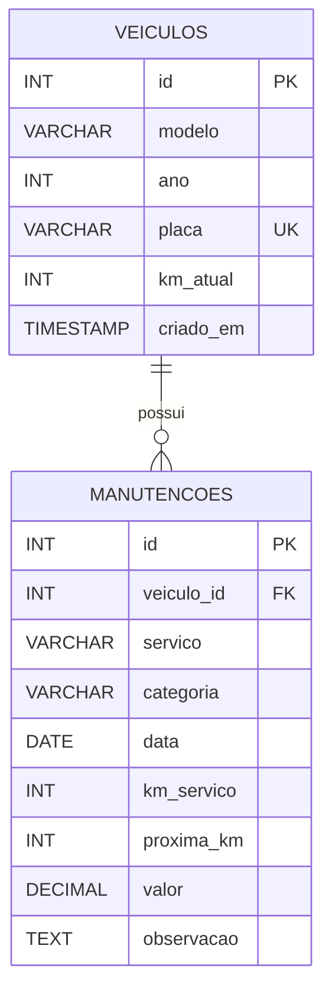

# Garagem Digital

**Diário de bordo e gerenciamento de manutenções automotivas**


Projeto acadêmico desenvolvido para a segunda avaliação da disciplina de Desenvolvimento Web da Universidade Federal Fluminense (UFF), em 2026.

## Aplicação online

**Acesse:** [Garagem Digital](https://garagemdigital.rf.gd)

A aplicação está hospedada gratuitamente no InfinityFree, utilizando certificado SSL e redirecionamento automático de HTTP para HTTPS.

## Sobre o projeto

O Garagem Digital é uma aplicação web destinada ao gerenciamento do histórico de manutenções automotivas.

O sistema centraliza informações sobre veículos, revisões, trocas de peças, melhorias automotivas, quilometragem e despesas, facilitando o acompanhamento dos serviços realizados e das próximas revisões.

A proposta surgiu da dificuldade de organizar informações relacionadas à manutenção de veículos, que frequentemente ficam distribuídas entre notas fiscais, recibos, anotações e registros manuais.

A aplicação oferece uma interface centralizada, responsiva e de fácil utilização para consultar, cadastrar, atualizar e excluir essas informações.

## Objetivos

### Objetivo geral

Desenvolver uma aplicação web para gerenciamento de veículos e seus respectivos históricos de manutenção, aplicando os conceitos e tecnologias abordados na disciplina de Desenvolvimento Web.

### Objetivos específicos

- Centralizar informações sobre veículos e serviços automotivos.
- Facilitar o acompanhamento das próximas revisões.
- Permitir o controle dos gastos com manutenção.
- Implementar as quatro operações fundamentais de um CRUD.
- Utilizar um banco de dados relacional para armazenamento persistente.
- Desenvolver uma interface responsiva e intuitiva.
- Aplicar boas práticas de desenvolvimento e segurança.
- Disponibilizar a aplicação em um ambiente de hospedagem online.

## Funcionalidades

- Dashboard com indicadores de veículos e manutenções.
- Cadastro de veículos.
- Registro de serviços automotivos.
- Consulta do histórico de manutenções.
- Filtros por veículo, categoria e pesquisa textual.
- Cálculo dinâmico dos gastos conforme os filtros.
- Monitoramento de revisões por quilometragem.
- Atualização de veículos e manutenções.
- Exclusão individual de registros.
- Atualização automática da quilometragem dos veículos.
- Exclusão em cascata das manutenções vinculadas.
- Validação dos dados informados.
- Confirmação antes da exclusão de registros.
- Mensagens de sucesso, erro e validação.
- Interface responsiva.
- Acesso seguro por HTTPS.

## Páginas da aplicação

| Página | Arquivo | Descrição |
|---|---|---|
| Home | index.php | Dashboard com indicadores e veículos cadastrados |
| Quem Somos | quem_somos.php | Apresentação do projeto e dos integrantes |
| Cadastro | cadastro.php | Cadastro de veículos e manutenções |
| Consulta | consulta.php | Histórico de serviços, filtros e controle financeiro |
| Atualização | atualizar.php | Edição de veículos e manutenções |
| Exclusão | excluir.php | Remoção de veículos e manutenções |

## Operações CRUD

CRUD é o conjunto das quatro operações fundamentais utilizadas para manipulação de informações em um sistema.

| Operação | Página | Funcionalidade |
|---|---|---|
| Create | cadastro.php | Cadastro de veículos e serviços |
| Read | index.php e consulta.php | Consulta de informações |
| Update | atualizar.php | Edição de veículos e serviços |
| Delete | excluir.php | Remoção de registros |

Todas as operações são realizadas de forma integrada ao banco de dados relacional.

## Tecnologias utilizadas

| Tecnologia | Aplicação |
|---|---|
| HTML5 | Estrutura das páginas |
| CSS3 | Estilização e personalização visual |
| Bootstrap 5 | Layout responsivo e componentes de interface |
| JavaScript | Filtros, cálculos dinâmicos e interações |
| PHP 8 | Processamento de requisições e regras de negócio |
| PDO | Comunicação com o banco de dados |
| MySQL | Armazenamento persistente das informações |
| SQL | Criação, consulta e manipulação de registros |
| Git | Controle de versão |
| GitHub | Repositório do código-fonte |
| InfinityFree | Hospedagem da aplicação |
| HTTPS | Comunicação criptografada entre navegador e servidor |

## Arquitetura

A aplicação utiliza uma arquitetura web baseada em PHP, responsável pelo processamento das requisições, aplicação das regras de negócio e comunicação com o banco de dados MySQL.

O HTML, o CSS e o Bootstrap são utilizados na construção da interface, enquanto o JavaScript é responsável pelas interações realizadas diretamente no navegador.

A comunicação com o banco de dados é realizada por meio da extensão PDO do PHP.



### Camada de apresentação

Responsável pela interface visual e pelas interações com o usuário.

Tecnologias utilizadas:

- HTML5.
- CSS3.
- Bootstrap 5.
- JavaScript.

### Camada de processamento

Responsável pelo recebimento das requisições, validação dos dados, aplicação das regras de negócio e execução das operações CRUD.

Tecnologias utilizadas:

- PHP.
- PDO.

### Camada de dados

Responsável pelo armazenamento persistente das informações e pela manutenção da integridade dos registros.

Tecnologias utilizadas:

- MySQL.
- SQL.
- InnoDB.

## Estrutura do projeto

```text
trabalho-dev-web/
├── assets/
│   └── js/
│       └── app.js
├── config/
│   └── conexao.php
├── includes/
│   ├── header.php
│   ├── footer.php
│   ├── funcoes.php
│   └── formularios.php
├── .gitignore
├── .htaccess
├── README.md
├── banco.sql
├── banco_producao.sql
├── index.php
├── quem_somos.php
├── cadastro.php
├── consulta.php
├── atualizar.php
└── excluir.php
```

### Descrição dos arquivos

| Arquivo | Responsabilidade |
|---|---|
| index.php | Dashboard e apresentação dos veículos cadastrados |
| quem_somos.php | Informações acadêmicas e apresentação do projeto |
| cadastro.php | Processamento e formulários de cadastro |
| consulta.php | Consulta e apresentação do histórico de manutenções |
| atualizar.php | Processamento e formulários de atualização |
| excluir.php | Processamento das operações de exclusão |
| config/conexao.php | Configuração da conexão PDO com o MySQL |
| includes/header.php | Cabeçalho, menu de navegação e estilos compartilhados |
| includes/footer.php | Rodapé e carregamento dos scripts |
| includes/funcoes.php | Funções auxiliares, validações e regras compartilhadas |
| includes/formularios.php | Componentes reutilizáveis dos formulários |
| assets/js/app.js | Filtros, cálculos e interações no navegador |
| banco.sql | Criação e inicialização do banco de desenvolvimento |
| banco_producao.sql | Inicialização do banco no ambiente de hospedagem |
| .gitignore | Exclusão de arquivos privados do versionamento |
| .htaccess | Redirecionamento automático para HTTPS |
| README.md | Documentação técnica do projeto |

O arquivo privado `config/credenciais.php` pode ser criado em cada ambiente para substituir as configurações padrão de conexão.

Esse arquivo não deve ser versionado nem compartilhado publicamente.

## Mapa do site



## Modelagem do banco de dados

O sistema utiliza duas entidades principais: veículos e manutenções.

O relacionamento é do tipo um para muitos (1:N), permitindo que um veículo possua nenhuma, uma ou diversas manutenções.

Cada manutenção está obrigatoriamente vinculada a um veículo cadastrado.

### Diagrama entidade-relacionamento



### Tabela veiculos

Responsável pelo armazenamento das informações dos veículos cadastrados.

| Campo | Tipo | Descrição |
|---|---|---|
| id | INT | Chave primária autoincrementável |
| modelo | VARCHAR(100) | Modelo do veículo |
| ano | INT | Ano do veículo |
| placa | VARCHAR(10) | Identificador único do veículo |
| km_atual | INT | Quilometragem atual |
| criado_em | TIMESTAMP | Data e horário do cadastro |

### Tabela manutencoes

Responsável pelo armazenamento do histórico de serviços realizados nos veículos.

| Campo | Tipo | Descrição |
|---|---|---|
| id | INT | Chave primária autoincrementável |
| veiculo_id | INT | Chave estrangeira vinculada ao veículo |
| servico | VARCHAR(120) | Descrição do serviço realizado |
| categoria | VARCHAR(50) | Categoria do serviço |
| data | DATE | Data de realização |
| km_servico | INT | Quilometragem no momento do serviço |
| proxima_km | INT | Quilometragem prevista para a próxima revisão |
| valor | DECIMAL(10,2) | Custo do serviço |
| observacao | TEXT | Informações adicionais |

### Integridade referencial

O banco de dados utiliza mecanismos de integridade para garantir a consistência das informações armazenadas.

- Placas únicas por meio da restrição UNIQUE.
- Chaves primárias autoincrementáveis.
- Relacionamento por chave estrangeira.
- ON DELETE CASCADE.
- ON UPDATE CASCADE.
- Armazenamento utilizando InnoDB.
- Codificação UTF-8 com utf8mb4.

Ao excluir um veículo, todas as manutenções vinculadas a ele são automaticamente excluídas pelo banco de dados.

Esse comportamento evita a existência de registros de manutenção sem um veículo correspondente.

## Regras de negócio

### Cadastro de veículos

O cadastro de veículos contempla as seguintes informações:

- Modelo.
- Ano.
- Placa.
- Quilometragem atual.

Cada veículo deve possuir uma placa única.

Os dados informados são validados antes de serem armazenados no banco de dados.

### Cadastro de manutenções

Cada manutenção deve estar vinculada a um veículo existente.

O registro contempla:

- Veículo.
- Descrição do serviço.
- Categoria.
- Data de realização.
- Quilometragem do serviço.
- Quilometragem da próxima revisão.
- Valor.
- Observações adicionais.

### Categorias de manutenção

Os serviços podem ser classificados nas seguintes categorias:

- Revisão.
- Freios.
- Suspensão.
- Motor.
- Upgrade.
- Outros.

Essa classificação facilita a organização e a filtragem do histórico.

### Quilometragem

Ao cadastrar ou atualizar uma manutenção, a quilometragem do veículo é atualizada automaticamente quando a quilometragem do serviço é superior à atual.

A atualização automática utiliza o maior valor entre a quilometragem atual e a quilometragem informada no serviço.

A edição manual não permite uma quilometragem inferior à maior quilometragem existente no histórico do veículo.

Quando informada, a quilometragem da próxima revisão deve ser superior à quilometragem do serviço realizado.

### Próximas revisões

O sistema calcula a situação de cada manutenção com base na diferença entre a quilometragem prevista para a próxima revisão e a quilometragem atual do veículo.

```text
Quilometragem restante = Próxima revisão - Quilometragem atual
```

| Situação | Condição |
|---|---|
| Em dia | Mais de 1.500 km restantes |
| Atenção | Entre 1 e 1.500 km restantes |
| Vencida | Quilometragem prevista atingida ou ultrapassada |
| Sem prazo | Próxima revisão igual a zero |

Os indicadores são calculados individualmente para cada registro de manutenção.

O limite de 1.500 km foi definido como regra de negócio da aplicação para sinalizar a proximidade de uma revisão.

Esses indicadores possuem finalidade organizacional e não substituem as recomendações de manutenção do fabricante do veículo.

### Controle financeiro

O Dashboard apresenta a soma dos valores de todas as manutenções cadastradas.

A página de consulta recalcula o total exibido conforme os filtros aplicados pelo usuário.

Dessa forma, é possível consultar os gastos relacionados a determinado veículo, categoria ou conjunto de serviços.

### Exclusão de registros

O sistema permite excluir veículos e manutenções individualmente.

A exclusão é realizada utilizando o identificador único do registro, evitando que veículos com nomes ou placas semelhantes sejam confundidos.

Antes da exclusão, o usuário deve confirmar a operação.

Quando um veículo é excluído, seu histórico de manutenções também é removido por meio da integridade referencial do banco de dados.

## Segurança e boas práticas

Durante o desenvolvimento, foram incorporados mecanismos de validação, organização e proteção das informações.

### Proteção contra SQL Injection

As operações de banco de dados que recebem parâmetros do usuário utilizam PDO e prepared statements.

Essa abordagem separa os comandos SQL dos valores informados pelo usuário.

### Proteção contra XSS

As informações dinâmicas apresentadas nas páginas são tratadas por funções de escape HTML.

Isso reduz o risco de interpretação de conteúdos inseridos pelo usuário como código executável no navegador.

### Proteção CSRF

Os formulários responsáveis por operações de alteração de dados utilizam tokens CSRF associados à sessão PHP.

Esses tokens são validados no servidor antes da execução das operações.

### Validação de dados

Os dados recebidos pelos formulários são validados no servidor antes da execução das operações de cadastro e atualização.

A validação não depende exclusivamente dos controles existentes no navegador.

### Transações

As operações que envolvem múltiplas alterações relacionadas utilizam transações de banco de dados.

Esse mecanismo contribui para evitar inconsistências quando uma operação não pode ser concluída integralmente.

### Post/Redirect/Get

Após o processamento de formulários enviados por POST, a aplicação utiliza redirecionamento para uma página GET.

Essa estratégia reduz a possibilidade de reenvio acidental de formulários ao atualizar a página.

### Prevenção de envios duplicados

O JavaScript auxilia na prevenção de múltiplos envios de formulários, desabilitando temporariamente os botões de submissão.

### Gerenciamento de credenciais

As credenciais do ambiente de produção são mantidas em um arquivo separado da configuração padrão do projeto.

O arquivo `config/credenciais.php` não deve ser incluído no repositório Git.

### Tratamento de erros

Erros internos de banco de dados devem ser registrados no ambiente do servidor, enquanto mensagens adequadas são apresentadas ao usuário.

A exibição pública de detalhes técnicos de depuração deve permanecer desativada no ambiente de produção.

### HTTPS

A aplicação utiliza certificado SSL disponibilizado pela hospedagem.

O arquivo `.htaccess` realiza o redirecionamento permanente das requisições HTTP para HTTPS.

Isso permite que a comunicação entre o navegador e o servidor seja criptografada.

## Limitações da aplicação

O Garagem Digital foi desenvolvido para fins acadêmicos.

A versão atual não implementa:

- Autenticação de usuários.
- Controle de permissões.
- Separação de registros por usuário.
- Notificações automáticas de manutenção.
- Integrações com sistemas externos.

Como a aplicação está disponível publicamente e não possui autenticação, qualquer visitante pode acessar e modificar os registros.

Portanto, devem ser utilizados exclusivamente dados fictícios e demonstrativos.

Os mecanismos de segurança implementados não substituem um sistema de autenticação e autorização necessário para uma aplicação comercial.

## Instalação local

### Pré-requisitos

- PHP 8 ou versão compatível.
- MySQL ou MariaDB compatível.
- Extensão pdo_mysql.
- Apache ou servidor nativo do PHP.
- Git.

Também é possível utilizar o XAMPP, que disponibiliza um ambiente integrado para execução de aplicações PHP com banco de dados.

### 1. Clonar o repositório

```bash
git clone https://github.com/lh2703/trabalho-dev-web.git
cd trabalho-dev-web
```

### 2. Configurar o banco de dados

Importar o arquivo `banco.sql` pelo phpMyAdmin.

Alternativamente, em um terminal compatível com redirecionamento de entrada, executar:

```bash
mysql -u root -p < banco.sql
```

O arquivo SQL contém a estrutura necessária para criação do banco de dados e das tabelas utilizadas pela aplicação.

Também são disponibilizados registros fictícios para demonstração das funcionalidades.

### 3. Configurar a conexão

O arquivo `config/conexao.php` contém as configurações padrão de desenvolvimento local.

Caso seja necessário utilizar outras credenciais, criar o arquivo `config/credenciais.php`, seguindo o exemplo:

```php
<?php

$host = "localhost";
$dbname = "garagem_digital";
$user = "root";
$pass = "";
$port = 3306;
```

Os valores devem ser ajustados conforme as configurações do ambiente local.

Nunca publicar credenciais reais no repositório.

### 4. Executar a aplicação

Na pasta raiz do projeto, executar:

```bash
php -S localhost:8000
```

Acessar:

http://localhost:8000

O servidor nativo do PHP não interpreta as regras do arquivo `.htaccess`, permitindo a execução local sem o redirecionamento para o endereço de produção.

### Execução utilizando XAMPP

Também é possível executar o projeto utilizando o XAMPP.

1. Instalar o XAMPP.
2. Iniciar os serviços Apache e MySQL.
3. Copiar a pasta do projeto para o diretório htdocs.
4. Importar o arquivo banco.sql pelo phpMyAdmin.
5. Configurar a conexão com o banco de dados.
6. Desativar ou renomear temporariamente o arquivo .htaccess no ambiente local.
7. Acessar a aplicação pelo navegador.

Exemplo:

http://localhost/trabalho-dev-web/

O arquivo `.htaccess` deve ser desativado apenas no ambiente local quando necessário, pois sua configuração de produção redireciona as requisições para o endereço público da aplicação.

## Hospedagem

O projeto está hospedado gratuitamente no InfinityFree.

| Informação | Descrição |
|---|---|
| Provedor | InfinityFree |
| Domínio | garagemdigital.rf.gd |
| Linguagem de servidor | PHP |
| Banco de dados | MySQL |
| Certificado SSL | Disponibilizado pela hospedagem |
| Protocolo | HTTPS |
| Controle de versão | GitHub |

### Endereço da aplicação

https://garagemdigital.rf.gd

### Processo de publicação

Para realizar uma nova publicação:

1. Criar uma conta de hospedagem no InfinityFree.
2. Configurar um domínio ou subdomínio.
3. Criar um banco de dados MySQL.
4. Acessar o phpMyAdmin.
5. Importar o arquivo banco_producao.sql em um banco novo.
6. Enviar os arquivos da aplicação para o diretório htdocs.
7. Criar o arquivo config/credenciais.php no servidor.
8. Configurar os dados de conexão do ambiente.
9. Testar as operações CRUD.
10. Validar o certificado SSL.
11. Configurar o redirecionamento automático para HTTPS.

O arquivo `banco_producao.sql` é destinado à inicialização do banco de produção, sem a necessidade de executar comandos de criação de um novo banco de dados.

Não é necessário importar novamente o arquivo SQL a cada atualização do código.

### Redirecionamento HTTPS

O arquivo `.htaccess` contém a configuração de redirecionamento permanente:

```apache
RewriteEngine On

# Redirecionamento permanente de HTTP para HTTPS
RewriteCond %{HTTPS} !=on
RewriteRule ^ https://garagemdigital.rf.gd%{REQUEST_URI} [R=301,L]
```

Dessa forma, os acessos realizados utilizando HTTP são automaticamente direcionados para HTTPS.

Caso o projeto seja publicado em outro domínio, o endereço presente na regra deverá ser atualizado.

### Arquivos de publicação

Os arquivos necessários para execução da aplicação no servidor são:

```text
htdocs/
├── assets/
├── config/
│   ├── conexao.php
│   └── credenciais.php
├── includes/
├── .htaccess
├── index.php
├── quem_somos.php
├── cadastro.php
├── consulta.php
├── atualizar.php
└── excluir.php
```

Os arquivos SQL, a pasta `.git`, as credenciais locais e as documentações internas não devem ser enviados para o diretório público da hospedagem.

O arquivo de credenciais de produção deve ser configurado separadamente no servidor.

## Testes e validação

A aplicação foi submetida a testes manuais preliminares durante o desenvolvimento e após a publicação no ambiente de hospedagem.

Os principais cenários de validação do sistema são:

| Cenário | Resultado esperado |
|---|---|
| Cadastro de veículo | Registro armazenado e apresentado na Home |
| Cadastro com placa duplicada | Operação rejeitada |
| Cadastro de manutenção | Serviço vinculado ao veículo selecionado |
| Consulta de registros | Histórico apresentado corretamente |
| Filtro por veículo | Exibição dos serviços do veículo selecionado |
| Filtro por categoria | Exibição dos serviços da categoria selecionada |
| Pesquisa textual | Exibição dos registros correspondentes |
| Controle financeiro | Soma dos valores dos registros exibidos |
| Atualização de veículo | Alterações armazenadas no banco |
| Atualização de manutenção | Alterações refletidas no histórico |
| Atualização de quilometragem | Consistência entre veículo e manutenção |
| Exclusão de manutenção | Remoção do registro selecionado |
| Exclusão de veículo | Remoção do veículo e das manutenções vinculadas |
| Navegação entre páginas | Carregamento correto das páginas |
| Acesso por HTTPS | Conexão segura |
| Acesso por HTTP | Redirecionamento automático para HTTPS |

A aplicação utiliza dados fictícios para demonstração e validação de suas funcionalidades.

## Possíveis melhorias futuras

Embora a versão atual contemple as funcionalidades propostas para o trabalho acadêmico, o sistema poderá ser expandido futuramente.

Algumas possibilidades são:

- Autenticação e cadastro de usuários.
- Controle de permissões.
- Separação de veículos por proprietário.
- Notificações de revisões próximas.
- Gráficos de despesas por período.
- Relatórios financeiros.
- Exportação de dados em PDF ou CSV.
- Armazenamento de notas fiscais e comprovantes.
- Cadastro de oficinas e fornecedores.
- Controle de revisões por data e quilometragem.
- Implementação de testes automatizados.

Essas funcionalidades representam possibilidades de evolução e não fazem parte do escopo implementado na versão atual.

## Contexto acadêmico

| Informação | Descrição |
|---|---|
| Instituição | Universidade Federal Fluminense (UFF) |
| Disciplina | Desenvolvimento Web |
| Avaliação | Segunda avaliação |
| Ano | 2026 |
| Projeto | Garagem Digital |
| Modalidade | Aplicação web com banco de dados relacional |

O projeto foi desenvolvido com o objetivo de aplicar, de forma prática, os conceitos estudados na disciplina de Desenvolvimento Web.

A aplicação contempla o desenvolvimento de interfaces web, processamento no servidor, manipulação de banco de dados, operações CRUD, integração entre tecnologias e publicação em um ambiente de hospedagem.

## Integrantes

- Luis Henrique Trindade
- Felipe Rand

## Repositório

O código-fonte está disponível no GitHub:

https://github.com/lh2703/trabalho-dev-web

## Aplicação publicada

https://garagemdigital.rf.gd

---

**Garagem Digital — Diário de bordo e gerenciamento de manutenções automotivas.**

Projeto desenvolvido para fins acadêmicos — Universidade Federal Fluminense, 2026.