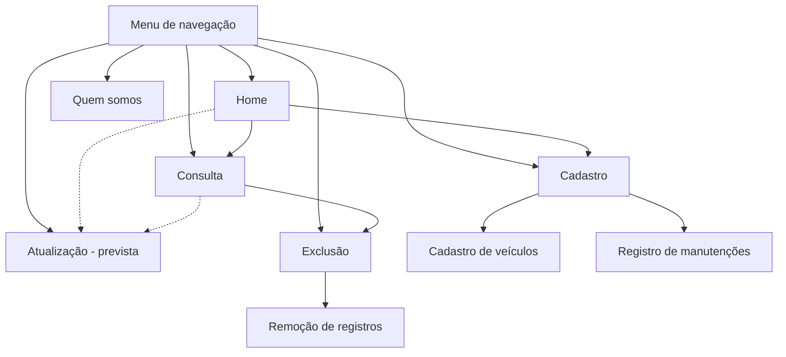
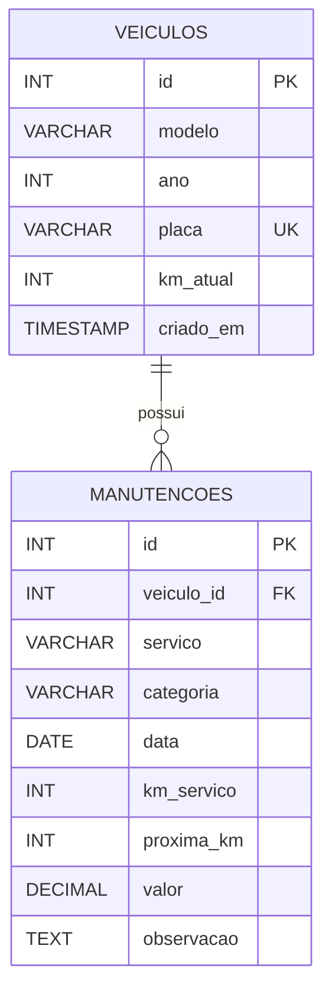

# Garagem Digital

**Diário de bordo e gerenciamento de manutenções automotivas**


Projeto acadêmico desenvolvido para a segunda avaliação da disciplina de Desenvolvimento Web da Universidade Federal Fluminense (UFF), 2026.

---

## Sobre o projeto

O Garagem Digital é uma aplicação web destinada ao controle do histórico de manutenção de veículos. A proposta surgiu da dificuldade de organizar informações sobre revisões, substituições de peças, melhorias automotivas, quilometragem e despesas, frequentemente dispersas em recibos e anotações.

O sistema centraliza essas informações em uma interface única, permitindo acompanhar os serviços realizados, os custos acumulados e a quilometragem prevista para as próximas revisões.

## Funcionalidades

- Dashboard com quantidade de veículos, serviços registrados e investimento total.
- Cadastro de veículos com modelo, ano, placa e quilometragem atual.
- Registro de serviços com categoria, data, quilometragem, próxima revisão, valor e observações.
- Histórico de manutenções associado a cada veículo.
- Filtro por veículo no banco de dados.
- Filtros instantâneos por texto e categoria no navegador.
- Soma dinâmica dos valores dos registros exibidos.
- Indicadores de situação das revisões por quilometragem.
- Exclusão de manutenções e veículos.
- Atualização automática da quilometragem do veículo ao registrar um serviço com quilometragem superior à atual.

### Operações CRUD

| Operação | Página | Descrição |
| --- | --- | --- |
| Create | `cadastro.php` | Cadastro de veículos e serviços |
| Read | `index.php` e `consulta.php` | Visualização de veículos, histórico e indicadores |
| Update | `atualizar.php` | Edição manual de registros (implementação pendente na versão consultada) |
| Delete | `excluir.php` | Remoção de veículos e serviços |

## Tecnologias utilizadas

| Tecnologia | Aplicação |
| --- | --- |
| HTML5 | Estrutura das páginas e formulários |
| CSS3 | Estilização da interface |
| Bootstrap 5 | Componentes visuais e layout responsivo |
| JavaScript | Filtros de registros e cálculo dinâmico de valores |
| PHP 8 | Processamento de formulários e regras de negócio |
| PDO | Conexão e execução de consultas ao banco |
| MySQL | Armazenamento relacional dos dados |
| Git | Controle de versão |
| GitHub | Hospedagem do código-fonte e colaboração |

## Arquitetura do sistema

A aplicação utiliza PHP para gerar páginas HTML no servidor e acessar o banco de dados MySQL por meio do PDO (PHP Data Objects).

Os formulários enviam dados ao servidor, responsável pelo processamento das informações e pela execução das operações no banco de dados.

O JavaScript realiza interações diretamente no navegador, como filtragem de registros e atualização dinâmica dos valores exibidos.

Os componentes compartilhados da interface, como cabeçalho e rodapé, ficam separados das páginas principais, permitindo a reutilização de código e facilitando a manutenção.

## Estrutura do projeto

```text
trabalho-dev-web/
├── assets/
│   └── js/
│       └── app.js
├── config/
│   └── conexao.php
├── includes/
│   ├── header.php
│   └── footer.php
├── .gitignore
├── README.md
├── banco.sql
├── index.php
├── quem_somos.php
├── cadastro.php
├── consulta.php
├── atualizar.php
└── excluir.php
```

### Descrição dos arquivos

| Arquivo | Responsabilidade |
| --- | --- |
| `index.php` | Página inicial e dashboard do sistema |
| `quem_somos.php` | Apresentação do projeto e dos desenvolvedores |
| `cadastro.php` | Cadastro de veículos e manutenções |
| `consulta.php` | Consulta do histórico de manutenções |
| `atualizar.php` | Página destinada à atualização de registros |
| `excluir.php` | Exclusão de veículos e manutenções |
| `config/conexao.php` | Configuração da conexão com o MySQL |
| `includes/header.php` | Cabeçalho e menu de navegação compartilhados |
| `includes/footer.php` | Rodapé e carregamento dos scripts |
| `assets/js/app.js` | Funcionalidades e interações em JavaScript |
| `banco.sql` | Script de criação e população inicial do banco |
| `.gitignore` | Configuração de arquivos ignorados pelo Git |
| `README.md` | Documentação do projeto |

## Mapa do site



As ligações tracejadas indicam o fluxo previsto de edição, ainda pendente de implementação no arquivo correspondente.

## Banco de dados

O sistema utiliza o banco de dados relacional MySQL, denominado `garagem_digital`.

A modelagem foi desenvolvida utilizando duas entidades principais:

- **Veículos:** responsável pelo armazenamento das informações dos veículos cadastrados.
- **Manutenções:** responsável pelo armazenamento dos serviços realizados em cada veículo.

O relacionamento entre as entidades é do tipo **1:N (um para muitos)**, ou seja, um veículo pode possuir diversas manutenções, enquanto cada manutenção pertence exclusivamente a um veículo.

### Diagrama entidade-relacionamento (DER)



### Tabela `veiculos`

Responsável pelo armazenamento das informações básicas dos veículos.

| Campo | Tipo | Descrição |
| --- | --- | --- |
| `id` | INT | Chave primária autoincrementável |
| `modelo` | VARCHAR(100) | Modelo do veículo |
| `ano` | INT | Ano do veículo |
| `placa` | VARCHAR(10) | Placa única de identificação |
| `km_atual` | INT | Quilometragem atual, com valor padrão 0 |
| `criado_em` | TIMESTAMP | Data e hora do cadastro |

### Tabela `manutencoes`

Responsável pelo armazenamento do histórico de serviços realizados nos veículos.

| Campo | Tipo | Descrição |
| --- | --- | --- |
| `id` | INT | Chave primária autoincrementável |
| `veiculo_id` | INT | Chave estrangeira para `veiculos.id` |
| `servico` | VARCHAR(120) | Descrição do serviço realizado |
| `categoria` | VARCHAR(50) | Categoria da manutenção |
| `data` | DATE | Data de realização do serviço |
| `km_servico` | INT | Quilometragem no momento do serviço |
| `proxima_km` | INT | Quilometragem prevista para a próxima revisão |
| `valor` | DECIMAL(10,2) | Valor financeiro do serviço |
| `observacao` | TEXT | Informações complementares opcionais |

### Integridade referencial

A chave estrangeira utiliza as seguintes restrições:

- `ON DELETE CASCADE`: ao excluir um veículo, todas as manutenções associadas são removidas automaticamente.
- `ON UPDATE CASCADE`: alterações na chave primária são propagadas para os registros relacionados.
- `UNIQUE`: impede o cadastro de veículos com placas duplicadas.

## Regras de negócio

### Controle de quilometragem

Ao registrar uma manutenção, o sistema compara a quilometragem informada no serviço com a quilometragem atual do veículo.

Caso a quilometragem do serviço seja superior, o sistema atualiza automaticamente a quilometragem do veículo.

Caso contrário, a quilometragem atual é mantida.

Essa regra permite registrar serviços antigos sem comprometer a informação atual do veículo.

### Monitoramento de revisões

O sistema calcula a situação das próximas revisões com base na quilometragem atual do veículo e na quilometragem prevista para o próximo serviço.

| Status | Condição |
| --- | --- |
| 🟢 Em dia | Faltam mais de 1.500 km para a próxima revisão |
| 🟡 Atenção | Faltam entre 1 e 1.500 km para a próxima revisão |
| 🔴 Vencida | A quilometragem atual atingiu ou ultrapassou a prevista |
| ⚪ Sem prazo | Não existe quilometragem prevista para a próxima revisão |

Os indicadores são calculados a partir das informações registradas pelo usuário e não substituem as recomendações de manutenção do fabricante.

### Controle financeiro

O sistema permite acompanhar os gastos relacionados às manutenções dos veículos.

Na página inicial, o investimento total é calculado por meio de uma consulta SQL que realiza a soma dos valores registrados no banco de dados.

Na página de consulta, o JavaScript recalcula dinamicamente o total de acordo com os registros exibidos após a aplicação dos filtros.

### Categorias de manutenção

Os serviços podem ser classificados nas seguintes categorias:

- Revisão;
- Freios;
- Suspensão;
- Motor;
- Upgrade;
- Outros.

Essa classificação facilita a organização e a consulta do histórico de serviços.

## Instalação e execução local

### Pré-requisitos

Para executar o projeto localmente, é necessário possuir:

- PHP 8;
- Extensão `pdo_mysql` habilitada;
- MySQL;
- Servidor Apache ou servidor de desenvolvimento do PHP;
- Git (opcional);
- Conexão com a internet para carregar os recursos do Bootstrap via CDN.

Também é possível utilizar ambientes de desenvolvimento como XAMPP, que disponibilizam PHP, Apache e ferramentas de gerenciamento do banco de dados.

### 1. Clonar o repositório

```bash
git clone https://github.com/lh2703/trabalho-dev-web.git
```

Acessar o diretório do projeto:

```bash
cd trabalho-dev-web
```

### 2. Configurar o banco de dados

O arquivo `banco.sql` contém a estrutura necessária para a criação do banco de dados, das tabelas e dos registros demonstrativos.

A importação pode ser realizada pelo phpMyAdmin:

```text
http://localhost/phpmyadmin
```

Ou diretamente pelo terminal:

```bash
mysql -u root -p < banco.sql
```

Recomenda-se realizar a importação em uma base nova para evitar conflitos com registros existentes.

### 3. Configurar a conexão

No arquivo `config/conexao.php`, ajustar as informações de conexão conforme o ambiente utilizado.

Configuração inicial para desenvolvimento local:

```php
$host = "localhost";
$dbname = "garagem_digital";
$user = "root";
$pass = "";
```

A aplicação utiliza PDO para realizar a conexão com o banco de dados.

As credenciais apresentadas são destinadas exclusivamente ao ambiente de desenvolvimento local. Credenciais de produção não devem ser publicadas no repositório.

### 4. Executar a aplicação

#### Utilizando XAMPP

Colocar a pasta do projeto dentro do diretório `htdocs`:

```text
xampp/htdocs/trabalho-dev-web/
```

Iniciar os serviços Apache e MySQL pelo painel do XAMPP.

Acessar a aplicação pelo navegador:

```text
http://localhost/trabalho-dev-web/
```

#### Utilizando o servidor nativo do PHP

Com o MySQL em execução, acessar a raiz do projeto e executar:

```bash
php -S localhost:8000
```

Acessar:

```text
http://localhost:8000/
```

## Hospedagem

A aplicação foi desenvolvida para ser compatível com serviços gratuitos de hospedagem que disponibilizam suporte a PHP e MySQL.

Entre as opções de hospedagem estão:

- [InfinityFree](https://www.infinityfree.com/)
- [X10hosting](https://x10hosting.com/)

### Processo de publicação

1. Criar uma conta no serviço de hospedagem.
2. Criar um banco de dados MySQL.
3. Importar a estrutura do arquivo `banco.sql` pelo phpMyAdmin.
4. Adaptar as instruções `CREATE DATABASE` e `USE`, caso o provedor crie o banco previamente.
5. Configurar as credenciais de conexão fornecidas pela hospedagem.
6. Enviar os arquivos da aplicação para o diretório público do servidor.
7. Validar as funcionalidades e a conexão com o banco de dados.

O arquivo SQL, a pasta `.git` e as credenciais de produção não devem ser disponibilizados publicamente.

**Acesso à aplicação:** URL de publicação a confirmar.

## Segurança e boas práticas

O projeto utiliza recursos que contribuem para a organização, manutenção e segurança da aplicação:

- Conexão com o banco de dados utilizando PDO.
- Consultas parametrizadas por meio de prepared statements.
- Tratamento de exceções na comunicação com o banco de dados.
- Utilização de `htmlspecialchars()` na exibição de informações.
- Separação dos arquivos de configuração.
- Reutilização de componentes de interface.
- Restrições de integridade no banco de dados.
- Controle de versão utilizando Git.

O sistema possui finalidade acadêmica. Para utilização em um ambiente de produção com dados reais, recomenda-se implementar autenticação, controle de acesso, proteção CSRF, validação no servidor e tratamento de erros sem exposição de informações internas.

## Validação e pendências

- [ ] Validar o cadastro de veículos.
- [ ] Verificar a restrição de placas duplicadas.
- [ ] Validar o registro de manutenções.
- [ ] Verificar a atualização automática da quilometragem.
- [ ] Testar os filtros de consulta.
- [ ] Validar o cálculo dos valores financeiros.
- [ ] Validar os indicadores de revisão.
- [ ] Implementar e testar a edição manual de registros.
- [ ] Testar a exclusão de manutenções.
- [ ] Testar a exclusão de veículos e seus registros relacionados.
- [ ] Publicar a aplicação em um serviço de hospedagem gratuito.
- [ ] Validar o funcionamento no ambiente de hospedagem.

## Contexto acadêmico

| Informação | Descrição |
| --- | --- |
| Instituição | Universidade Federal Fluminense (UFF) |
| Disciplina | Desenvolvimento Web |
| Avaliação | Segunda avaliação |
| Ano | 2026 |
| Projeto | Garagem Digital |
| Tema | Diário de bordo e gerenciamento de manutenções automotivas |

## Desenvolvedores

- Luis Henrique Trindade
- Felipe Rand

## Repositório

O código-fonte do projeto está disponível em:

[github.com/lh2703/trabalho-dev-web](https://github.com/lh2703/trabalho-dev-web)

---

Projeto desenvolvido para fins acadêmicos — Universidade Federal Fluminense (UFF), 2026.