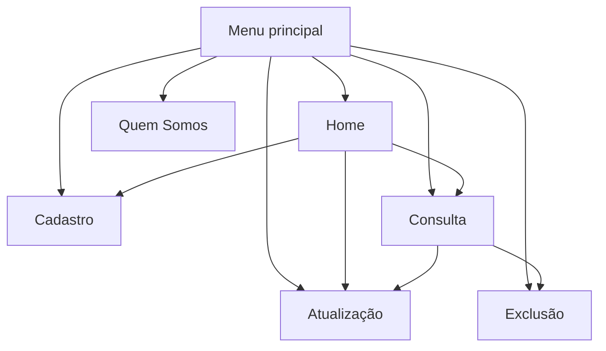
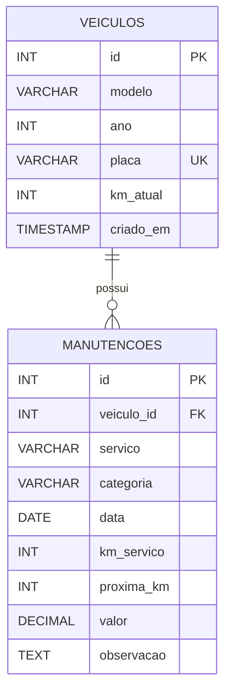

# Garagem Digital

**Diário de bordo e gerenciamento de manutenções automotivas**


Projeto acadêmico desenvolvido para a segunda avaliação da disciplina de **Desenvolvimento Web** da **Universidade Federal Fluminense (UFF)** — 2026.

- **Aplicação online (InfinityFree + HTTPS):** https://garagemdigital.rf.gd
- **Repositório:** https://github.com/lh2703/trabalho-dev-web

---

## Problema abordado e proposta

Informações sobre revisões, trocas de peças, quilometragem e gastos automotivos costumam ficar espalhadas entre notas fiscais, recibos e anotações manuais.

O **Garagem Digital** centraliza esse histórico em uma interface web responsiva, permitindo gerenciar veículos e manutenções, acompanhar gastos e monitorar prazos de próximas revisões.

---

## Páginas e operações CRUD

| Página | Arquivo | Operação CRUD | Descrição |
|---|---|---|---|
| **Home** | `index.php` | Read | Dashboard com indicadores (veículos, serviços e gasto total) e lista de veículos |
| **Quem Somos** | `quem_somos.php` | — | Apresentação do projeto, tecnologias e integrantes |
| **Cadastro** | `cadastro.php` | Create | Cadastro de veículos e registro de manutenções |
| **Consulta** | `consulta.php` | Read | Histórico de serviços com filtros (veículo, categoria e busca) e cálculo dinâmico de gastos |
| **Atualização** | `atualizar.php` | Update | Edição de veículos e manutenções |
| **Exclusão** | `excluir.php` | Delete | Remoção de manutenções individuais ou de veículos (em cascata) |

### Mapa do site



---

## Principais regras de negócio

- **Placa única:** não é permitido cadastrar dois veículos com a mesma placa (`UNIQUE`).
- **Quilometragem consistente:** ao registrar ou editar uma manutenção, o `km_atual` do veículo é atualizado automaticamente caso o serviço tenha quilometragem maior; na edição manual do veículo, não é permitido reduzir o `km_atual` abaixo do maior registro do histórico.
- **Status das próximas revisões** (calculado por `proxima_km - km_atual`):
  - **Em dia:** mais de 1.500 km restantes.
  - **Atenção:** entre 1 e 1.500 km restantes.
  - **Vencida:** quilometragem prevista atingida ou ultrapassada.
  - **Sem prazo:** `proxima_km` igual a `0`.
- **Controle financeiro dinâmico:** a página de consulta recalcula o valor total em tempo real via JavaScript conforme os filtros aplicados.

---

## Tecnologias utilizadas

| Camada | Tecnologias |
|---|---|
| **Front-end** | HTML5, CSS3 (`assets/css/style.css`), Bootstrap 5, JavaScript ES6 (`assets/js/app.js`) |
| **Back-end** | PHP 8, PDO (com prepared statements e transações) |
| **Banco de dados** | MySQL (InnoDB, `utf8mb4`) |
| **Infraestrutura** | InfinityFree (hospedagem gratuita com SSL/HTTPS via `.htaccess`), Git e GitHub |

---

## Banco de dados

Relacionamento **1:N** entre `veiculos` e `manutencoes`, com integridade referencial (`ON DELETE CASCADE` e `ON UPDATE CASCADE`): ao excluir um veículo, suas manutenções vinculadas são removidas automaticamente.



---

## Estrutura do projeto

```text
trabalho-dev-web/
├── assets/
│   ├── css/style.css       # Estilização personalizada
│   └── js/app.js           # Filtros dinâmicos, soma em tempo real e confirmações
├── config/
│   └── conexao.php         # Conexão PDO com MySQL (lê config/credenciais.php se existir)
├── includes/
│   ├── header.php          # Cabeçalho e menu de navegação
│   ├── footer.php          # Rodapé e scripts
│   ├── funcoes.php         # Validações, CSRF, XSS, flash messages e regras
│   └── formularios.php     # Campos reutilizáveis de veículos e manutenções
├── banco.sql               # Criação e seed do banco local
├── banco_producao.sql      # Criação e seed do banco na hospedagem
├── .htaccess               # Redirecionamento automático HTTP -> HTTPS
├── index.php
├── quem_somos.php
├── cadastro.php
├── consulta.php
├── atualizar.php
└── excluir.php
```

---

## Segurança e boas práticas aplicadas

- **SQL Injection:** consultas parametrizadas com PDO (*prepared statements*).
- **XSS:** escape de saídas HTML com `htmlspecialchars`.
- **CSRF:** tokens de sessão validados em todas as requisições `POST`.
- **Integridade e concorrência:** validação no servidor, transações com `FOR UPDATE` e padrão *Post/Redirect/Get*.
- **Proteção de credenciais:** dados de produção isolados em `config/credenciais.php` (fora do Git) e redirecionamento HTTPS em `.htaccess`.

---

## Como executar localmente

1. Clone o repositório:
   ```bash
   git clone https://github.com/lh2703/trabalho-dev-web.git
   cd trabalho-dev-web
   ```
2. Importe `banco.sql` no MySQL/phpMyAdmin.
3. Se necessário, crie `config/credenciais.php` com `$host`, `$dbname`, `$user`, `$pass` e `$port`.
4. Inicie o servidor embutido do PHP (não aplica o `.htaccess` de produção):
   ```bash
   php -S localhost:8000
   ```
5. Acesse `http://localhost:8000`.

> *(Obs.: o sistema tem fins acadêmicos, utiliza dados demonstrativos e não possui autenticação de usuários.)*

---

## Integrantes

- **Luis Henrique Trindade de Carvalho**
- **Felipe Rand Souza Oliveira**
