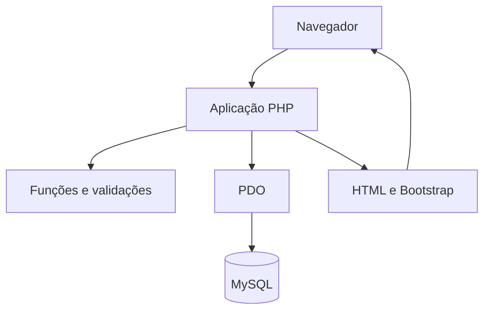
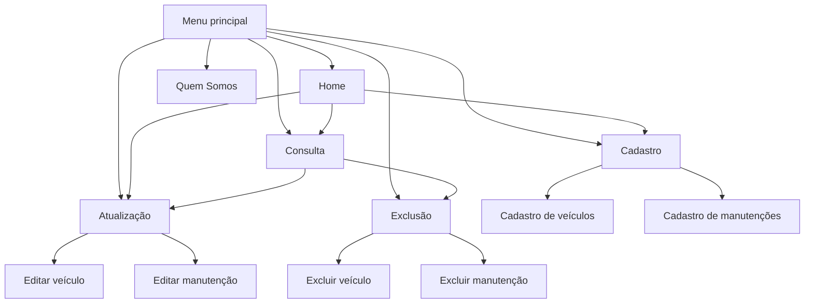
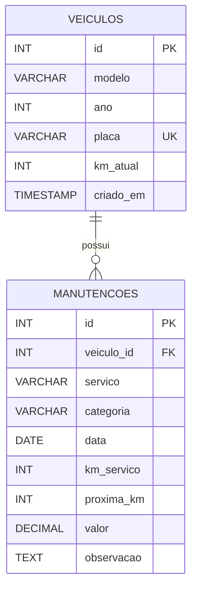

# Garagem Digital

**Diário de bordo e gerenciamento de manutenções automotivas**


Projeto acadêmico desenvolvido para a segunda avaliação
da disciplina de Desenvolvimento Web da Universidade
Federal Fluminense (UFF), 2026.

## Aplicação online

[Garagem Digital](http://garagemdigital.rf.gd)

Hospedagem gratuita realizada por meio do InfinityFree.

## Sobre o projeto

O Garagem Digital é uma aplicação web destinada ao
gerenciamento do histórico de manutenções automotivas.

O sistema centraliza informações sobre veículos, revisões,
trocas de peças, melhorias automotivas, quilometragem e
despesas, facilitando o acompanhamento dos serviços
realizados e das próximas revisões.

## Funcionalidades

- Dashboard com indicadores de veículos e manutenções.
- Cadastro de veículos.
- Registro de serviços automotivos.
- Consulta do histórico de manutenções.
- Filtros por veículo, categoria e pesquisa textual.
- Cálculo dinâmico dos gastos.
- Monitoramento de revisões por quilometragem.
- Atualização de veículos e manutenções.
- Exclusão de registros.
- Atualização automática da quilometragem.
- Exclusão em cascata das manutenções vinculadas.

## Operações CRUD

| Operação | Página | Funcionalidade |
|---|---|---|
| Create | cadastro.php | Cadastro de veículos e serviços |
| Read | index.php e consulta.php | Consulta de informações |
| Update | atualizar.php | Edição de veículos e serviços |
| Delete | excluir.php | Remoção de registros |

## Tecnologias utilizadas

| Tecnologia | Aplicação |
|---|---|
| HTML5 | Estrutura das páginas |
| CSS3 | Estilização |
| Bootstrap 5 | Layout responsivo e componentes |
| JavaScript | Filtros e interações |
| PHP 8 | Processamento e regras de negócio |
| PDO | Comunicação com o banco de dados |
| MySQL | Armazenamento das informações |
| Git | Controle de versão |
| GitHub | Repositório do código |
| InfinityFree | Hospedagem da aplicação |

## Arquitetura

A aplicação utiliza uma arquitetura web baseada em PHP,
responsável pelo processamento das requisições e pela
comunicação com o banco de dados MySQL.

O HTML e o Bootstrap são utilizados na construção da
interface, enquanto o JavaScript é responsável pelas
interações realizadas diretamente no navegador.



## Estrutura do projeto

```text
trabalho-dev-web/
├── assets/
│   └── js/
│       └── app.js
├── config/
│   └── conexao.php
├── includes/
│   ├── header.php
│   ├── footer.php
│   ├── funcoes.php
│   └── formularios.php
├── .gitignore
├── README.md
├── banco.sql
├── banco_producao.sql
├── index.php
├── quem_somos.php
├── cadastro.php
├── consulta.php
├── atualizar.php
└── excluir.php
```

O arquivo privado config/credenciais.php pode ser criado
em cada ambiente para substituir as configurações padrão
de conexão. Esse arquivo não deve ser versionado.

## Mapa do site



## Modelagem do banco de dados

O sistema utiliza duas entidades principais: veículos
e manutenções.

O relacionamento é do tipo 1:N, permitindo que um
veículo possua diversas manutenções.



### Tabela veiculos

| Campo | Tipo | Descrição |
|---|---|---|
| id | INT | Chave primária |
| modelo | VARCHAR(100) | Modelo do veículo |
| ano | INT | Ano do veículo |
| placa | VARCHAR(10) | Identificador único |
| km_atual | INT | Quilometragem atual |
| criado_em | TIMESTAMP | Data de cadastro |

### Tabela manutencoes

| Campo | Tipo | Descrição |
|---|---|---|
| id | INT | Chave primária |
| veiculo_id | INT | Chave estrangeira |
| servico | VARCHAR(120) | Serviço realizado |
| categoria | VARCHAR(50) | Categoria do serviço |
| data | DATE | Data de realização |
| km_servico | INT | Quilometragem do serviço |
| proxima_km | INT | Próxima revisão |
| valor | DECIMAL(10,2) | Custo do serviço |
| observacao | TEXT | Informações adicionais |

### Integridade referencial

- Placas únicas.
- Chaves primárias autoincrementáveis.
- Relacionamento por chave estrangeira.
- ON DELETE CASCADE.
- ON UPDATE CASCADE.
- Armazenamento utilizando InnoDB.
- Codificação UTF-8 com utf8mb4.

## Regras de negócio

### Quilometragem

Ao cadastrar ou atualizar uma manutenção, a quilometragem
do veículo é atualizada automaticamente quando a
quilometragem do serviço é superior à atual.

A edição manual não permite uma quilometragem inferior
à maior quilometragem existente no histórico do veículo.

### Próximas revisões

| Situação | Condição |
|---|---|
| Em dia | Mais de 1.500 km restantes |
| Atenção | Entre 1 e 1.500 km restantes |
| Vencida | Quilometragem prevista atingida ou ultrapassada |
| Sem prazo | Próxima revisão igual a zero |

Os indicadores são calculados individualmente para
cada registro de manutenção.

### Controle financeiro

O Dashboard apresenta a soma dos valores de todas
as manutenções.

A página de consulta recalcula o total exibido conforme
os filtros aplicados pelo usuário.

## Segurança e boas práticas

- PDO e prepared statements.
- Validação de dados no servidor.
- Escape de informações HTML.
- Proteção CSRF nos formulários.
- Transações de banco de dados.
- Post/Redirect/Get.
- Controle de integridade referencial.
- Prevenção de envios duplicados pelo JavaScript.
- Separação das credenciais de produção.
- Tratamento de erros sem exposição de detalhes internos.

A aplicação possui finalidade acadêmica e não implementa
autenticação de usuários. Portanto, a versão pública
deve utilizar exclusivamente dados fictícios.

## Instalação local

### Pré-requisitos

- PHP 8.
- MySQL ou MariaDB compatível.
- Extensão pdo_mysql.
- Apache ou servidor nativo do PHP.
- Git.

### Clonar o repositório

```bash
git clone https://github.com/lh2703/trabalho-dev-web.git
cd trabalho-dev-web
```

### Configurar o banco

Importar o arquivo banco.sql pelo phpMyAdmin ou executar:

```bash
mysql -u root -p < banco.sql
```

O arquivo config/conexao.php contém as configurações
padrão de desenvolvimento local.

Caso seja necessário utilizar outras credenciais, criar
o arquivo config/credenciais.php, seguindo o exemplo:

```php
<?php

$host = "localhost";
$dbname = "garagem_digital";
$user = "root";
$pass = "";
$port = 3306;
```

Nunca publicar credenciais reais no repositório.

### Executar a aplicação

```bash
php -S localhost:8000
```

Acessar:

http://localhost:8000

Também é possível executar o projeto utilizando XAMPP,
colocando os arquivos no diretório htdocs.

## Hospedagem

O projeto está hospedado no InfinityFree.

Para realizar uma nova publicação:

1. Criar uma conta de hospedagem.
2. Configurar um banco MySQL.
3. Importar banco_producao.sql.
4. Enviar os arquivos da aplicação para htdocs.
5. Criar config/credenciais.php no servidor.
6. Configurar os dados de conexão do ambiente.
7. Testar as operações CRUD.
8. Configurar e validar HTTPS.

Arquivos SQL, credenciais locais, a pasta .git e
documentações internas não devem ser enviados para
o diretório público da hospedagem.

## Contexto acadêmico

| Informação | Descrição |
|---|---|
| Instituição | Universidade Federal Fluminense |
| Disciplina | Desenvolvimento Web |
| Avaliação | Segunda avaliação |
| Ano | 2026 |
| Projeto | Garagem Digital |

## Integrantes

- Luis Henrique Trindade
- Felipe Rand

## Repositório

https://github.com/lh2703/trabalho-dev-web

---

Projeto desenvolvido para fins acadêmicos — UFF, 2026.